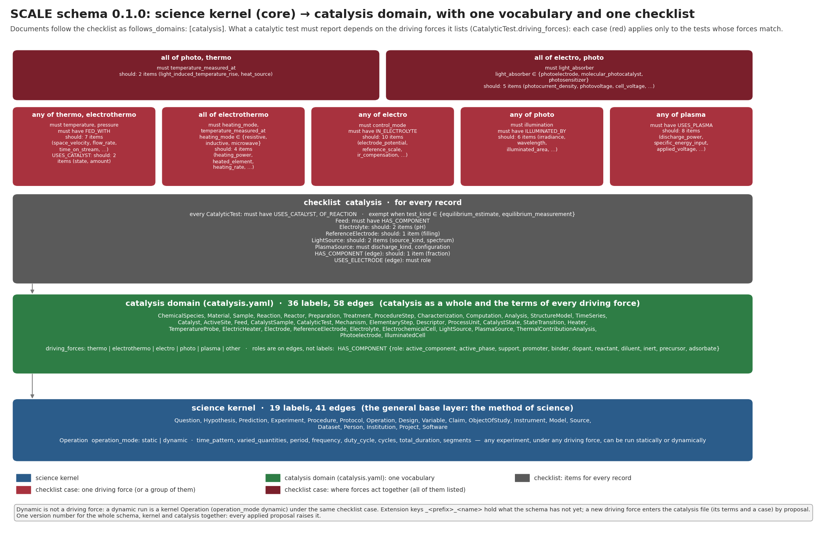

# SCALE

**Shared Concepts, Attributes, and Links with Evidence: one shared framework for evidence-backed scientific
knowledge graphs across domains.**

SCALE is a schema, a set of deterministic tools and a set of agent skills for building knowledge graphs in
which every record stays linked to the evidence behind it. **Concepts** are the node labels, edge types,
property definitions and value kinds; **attributes** are the properties of nodes and edges; **links** are
typed, directed edges; **evidence** (a source, a locator and a short verbatim quote) is attached to every
node and edge that states something. People and AI agents curate sources into such graphs, query them with
their evidence, and change the schema through reviewed proposals. Every value keeps its source location,
its reported unit and its verbatim evidence.

The framework is general: a **science kernel** holds what any science shares (questions, hypotheses,
experiments, claims, sources, people…), and **domains** build on it. **Catalysis** is the first domain,
and for now the only one: thermocatalysis, electrocatalysis, photocatalysis and plasma catalysis, and their
combinations. Other fields may add domains later.



## Use it: one line

```bash
uvx scale-schema call status
```

[uv](https://docs.astral.sh/uv/) fetches SCALE and runs it, with nothing to install or configure.
Documents live in a working directory, `~/.scale/workspace` (or `$SCALE_WORKSPACE`); each scale-graph
document pins its schema version itself.

Not on PyPI yet: until the first release is published, run from a clone with
`uvx --from /path/to/scale scale-schema call status` (or `--from git+https://github.com/hlxin/scale`,
with access to the repository), as in [docs/integrate.md](docs/integrate.md).

```bash
uvx scale-schema graph describe CatalyticTest --domain catalysis         # what a record may and must say
uvx scale-schema call example '{"name": "electro"}'                      # copy a public example to query
uvx scale-schema call                                                     # list every tool (JSON in, JSON out)
```

**For AI agents**, register SCALE as an MCP server:

```bash
claude mcp add scale -- uvx scale-schema mcp
```

Any other agent system can run `uvx scale-schema call <tool> '<json>'` as a shell tool, or use HTTP
(`scale serve`) or Python (`from scale.api import ScaleToolkit`). Pin a version with
`uvx scale-schema@0.1.0 …`. See [docs/integrate.md](docs/integrate.md) and [AGENTS.md](AGENTS.md).

Prefer a normal install? Run `pip install scale-schema`, then use `scale …` instead of
`uvx scale-schema …`. The Python package is named `scale-schema` (the names `scale` and `schema` are taken
on PyPI); its commands are `scale` and `scale-schema`.

## What's inside

SCALE's schema has **two layers: the science kernel and the domains**. A domain's graph schema manifest
assembles the kernel with that domain's files; there is one domain today, catalysis, in one folder.

- **The science kernel** ([`core/`](core/README.md)): the general base layer (the method of science, what is
  studied, what science is done with and who does it), with the value object, the evidence item, the
  record reference and stewardship ([how a domain builds on it](core/graph/README.md)).
- **The catalysis domain** ([`domain/`](domain/README.md), declared in `domain/DOMAIN.yaml`,
  `domain: catalysis`):
  - the catalysis file `catalysis.yaml` (species, materials, reactions, catalysts…, and the terms of every
    driving force: heat, electrically delivered heat, potential, light, plasma and their combinations),
    assembled with the kernel by [`domain/graph/scale-graph.yaml`](domain/graph/scale-graph.yaml). Its one
    checklist lists what a record **must** and **should** report; the items for a catalytic test apply by
    the driving forces the test lists (`driving_forces`), and documents follow it as
    `follows_domains: ["catalysis"]` (`--domain catalysis` shows it). Every concept is provisional;
  - competency questions: scale-graph query plans with their expected answers, run on public examples
    (`scale domains cq`);
  - examples: [synthetic scale-graph examples](domain/examples/scale-graph/) (invented values and sources),
    one per driving force and combination of forces.
- **A real example** ([`examples/methanol-synthesis-pre1966/`](examples/methanol-synthesis-pre1966/README.md)): the
  historical methanol-synthesis literature on CO/CO2 + H2 published before 1966 (105 sources),
  curated from the source texts into one graph with capped quotes, and the manuscript's questions as query plans; the
  repository's tests run on it.
- **Tools** ([`tools/`](tools/README.md)): the `scale` Python package and command, the versioned skills for
  agents, and their tests.
- **Governance** ([`governance/`](governance/GOVERNANCE.md)): the owner and the reviewers, the review rule,
  the version bump and the release process.
- **Releases** ([`releases/`](releases/README.md)): immutable, digested releases, built by a person. None has
  been built yet; the first will be `v0.1.0`.

SCALE has one data format: scale-graph documents (node-link JSON) that pin the schema version they follow.
A second domain would revisit the one-folder layout ([docs/architecture.md](docs/architecture.md)).

Three workflows run across all of it: curating sources with evidence, querying with context (queries
decline rather than guess), and evolving the schema through reviewed proposals. Agents propose; people
approve. The judgment work (extraction, writing query plans) is done by your model; SCALE's tools are
deterministic. See [implementation status](docs/implementation-status.md).

## Schema versions

The schema has **one version number** for the science kernel and the catalysis domain together: the
`version` of the catalysis manifest, `domain/graph/scale-graph.yaml`. The kernel file and the catalysis file
carry none of their own; `core/CORE.yaml`, `domain/DOMAIN.yaml` and `scale-release.yaml` state the same
number, and `scale domains check` requires them to agree. Every applied proposal raises it, whether it
changes the kernel, the catalysis file or both, and freezes the version it replaces beside the manifest
(`graph/frozen/`), so a document stays readable under the version it pins (`graph.schema_version`).

The schema is at **0.1.0**, the first version of this repository's numbering (2026-10-08):

| version | spec digest (sha256 of the spec document) |
|---|---|
| scale-graph 0.1.0 | `3c2fa7205a7bae5e0bbfa7d87826ff7ab7803e78536129064101c7d5a2c02006` |

A version number names a schema only within this numbering. **Bind a schema by its digest**: `scale graph
spec` writes a version's spec document (the assembled schema as canonical JSON, `lineage: scale`) and prints
its sha256, the same whether the version is the head or frozen, and `scale graph spec --expect <sha256>`
says whether a version and digest you hold are this repository's (`pgraph.identify`). Releases ship every
version's spec document, `scale graph verify` checks that each keeps its digest, and a kg-bundle names
its schema by version and digest. A document that pins a version these tools do not hold is reported as
such (newer than the head, or not a version of this repository), never read under another version of the
same number.

**Documents of the earlier contents of github.com/hlxin/scale.** This repository replaced the earlier contents of
`github.com/hlxin/scale` (its own scale-graph numbering 0.1.0-0.8.0, package scale-catalysis); versions here restart
at 0.1.0 and are a separate line. This repository continues the consortium schema repository instead (see the
[CHANGELOG](CHANGELOG.md)). The earlier version numbers name other schemas: a document does not carry its schema's
digest, so these tools would read one pinning 0.1.0 under this 0.1.0, and one pinning a later number as a version
they do not hold. Re-curate such documents under this numbering; do not validate them as they are.

## Contribute

Open an issue to comment or suggest in plain language ([comment form](https://github.com/hlxin/scale/issues/new?template=comment.yml),
[contribution form](https://github.com/hlxin/scale/issues/new?template=contribution.yml)), or a pull request
on a short-lived branch. The owner, or an agent at their request, prepares a pull request from an issue and
credits its author.

**How the schema evolves.** A schema change is a pull request that carries a proposal
(`scale proposal new`, `scale proposal check`); like every change it needs one approving review from
a reviewer other than its author (the owner is a reviewer; the owner's own pull requests are merged under the
bootstrap rule until another reviewer joins) ([governance/GOVERNANCE.md](governance/GOVERNANCE.md)). After it merges, the proposal is
applied on `main` and the schema version moves on. People and agents open pull requests; a person approves and merges.

See [CONTRIBUTING.md](CONTRIBUTING.md).

## Develop

```bash
git clone https://github.com/hlxin/scale && cd scale && uv run --extra dev scale check
```

That one line sets up the environment and runs every check of CI's `test` jobs (a few minutes). After a
change, run `uv run --extra dev scale check` again, or `… scale check --fast` to skip the tests.

## Documentation

[Commands](docs/commands.md) · [Agents](docs/integrate.md) · [Architecture and principles](docs/architecture.md) ·
[Curation](docs/curation.md) · [Querying](docs/querying.md) · [Schema evolution](docs/evolution.md) ·
[Agents and people](docs/agents.md) · [Supporting information](domain/docs/supporting-information.md) ·
[Style](docs/style.md) · [Decision records](docs/decisions/0001-scale-0.1.0.md) ·
[The catalysis domain](domain/README.md) · [Core](core/README.md) ·
[The science kernel and how a domain builds on it](core/graph/README.md) · [Tools](tools/README.md) ·
[Governance](governance/README.md) · [Changelog](CHANGELOG.md)

## Licence and citation

Code is under the MIT licence ([LICENSE](LICENSE)); the vocabulary, curated records and documentation are
under CC-BY-4.0 ([LICENSES/](LICENSES/); [REUSE.toml](REUSE.toml) gives every file its licence, and
`scale check` runs `reuse lint`); third-party material stays under its owners' terms, listed in
[NOTICE](NOTICE). Contributions come in under the licence of their path. Curated records quote their sources
only in short, capped excerpts, every committed document is public, and project data not yet cleared for
publication is never committed ([governance/licensing.md](governance/licensing.md)). To cite SCALE, see
[CITATION.cff](CITATION.cff).
